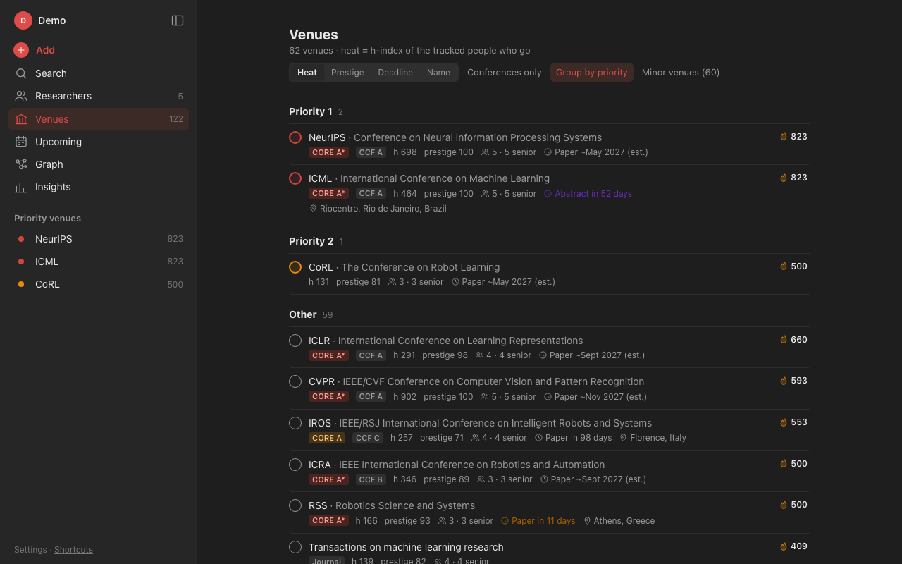

# confmap

Track researchers, see which conferences the senior people actually go to, how prestigious those venues are, and plan how to get there. Todoist-style UI (see [DESIGN.md](DESIGN.md)), plus an MCP endpoint so Claude Code or Codex can add researchers from a link.

Live: https://confmap.knhdixh.com



## What it does

| | |
|---|---|
| **Researchers** | Paste a link (OpenAlex, ORCID, Semantic Scholar, Google Scholar*, dblp*, personal homepage) or a name. Imports h-index, citations per year, fields (OpenAlex topics), keywords, top and recent papers, and every venue they publish at. |
| **Venues** | Each venue gets **prestige** (mean of CORE rank, CCF rank, citation h-index) and **heat** (sum of the h-index of your tracked people, weighted by how much they published there in the last 4 years). Todoist priorities p1–p4 for your own ranking. |
| **How to get there** | Next deadline (or an estimate from last year), place, dates, acceptance rates, the top authors there in the last 3 years (one click to track them), and a plan list of tasks. |
| **Upcoming** | Your tasks plus abstract/paper deadlines of your venues, grouped by day. |
| **Graph** | Obsidian-style force graph of researchers ↔ venues (↔ fields). |
| **Insights** | Spearman correlations: citation h-index vs heat, CORE rank vs heat, citations vs CORE, researcher h-index vs venue prestige. |

\* Google Scholar and dblp block reads from Cloudflare; the app then asks for the name.

## How it works

- Cloudflare Worker (plain JS, no build step) + static frontend in `public/` + D1.
- `src/openalex.js`: link resolution and ingestion. One researcher ≈ 7 OpenAlex calls, all using `select`/`group_by` so the Worker stays inside the free plan's CPU limit.
- `public/lib/*.js`: maths shared by the browser and the Worker (prestige, heat, Spearman, deadlines, Todoist quick-add parsing).
- `migrations/0003_confs.sql`: 386 CS conferences (CORE/CCF ranks, editions, deadlines, acceptance rates) generated from [ccfddl/ccf-deadlines](https://github.com/ccfddl/ccf-deadlines) (MIT) by `scripts/build-confs.mjs`.
- A daily cron re-imports the three stalest researchers (data older than 30 days).
- Sign-in with passkeys. Agents use personal tokens (only SHA-256 hashes are stored).

## MCP (Claude Code, Codex)

Create a token in **Settings**, then:

```bash
claude mcp add --transport http confmap https://confmap.knhdixh.com/mcp --header "Authorization: Bearer $CONFMAP_TOKEN"
```

```toml
# ~/.codex/config.toml
[mcp_servers.confmap]
url = "https://confmap.knhdixh.com/mcp"
bearer_token_env_var = "CONFMAP_TOKEN"
```

Tools: `add_researcher`, `list_researchers`, `get_researcher`, `refresh_researcher`, `remove_researcher`, `list_venues`, `get_venue`, `set_venue_priority`, `insights`, `add_task`, `list_tasks`, `update_task`.

## Run locally

```bash
npm install
cp .dev.vars.example .dev.vars   # add OPENALEX_KEY
npm run dev                      # http://localhost:8787, "Dev login" on the sign-in page
npm test
```

## Deploy your own

`npx wrangler d1 create confmap`, put the id in `wrangler.jsonc`, set the secret `OPENALEX_KEY` (`npx wrangler secret put OPENALEX_KEY`), then `npm run deploy`.

Refresh conference data: clone ccfddl and run `node scripts/build-confs.mjs <clone> migrations/000N_confs_refresh.sql`.

## Limits

- OpenAlex merges or splits author profiles imperfectly; names with several strong matches ask you to choose.
- "Last known institution" comes from OpenAlex and is sometimes outdated.
- Deadline data covers CS conferences listed by ccfddl; other fields show rankings from citations only.
